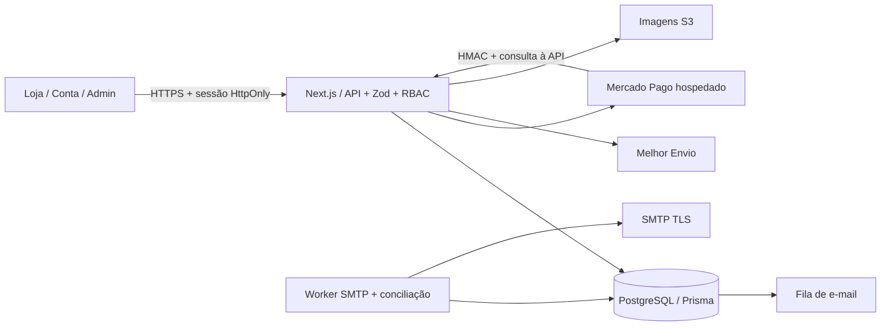

# Arquitetura

Monólito modular Next.js: React entrega a experiência pública e administrativa; Route Handlers TypeScript fazem autorização e validação Zod; Prisma com driver PostgreSQL acessa dados. Segredos ficam apenas no servidor. Valores monetários são inteiros em centavos. O frontend nunca define o valor financeiro do pedido.

## Banco

- `User` tem `roleVersion` e marcador de anonimização `deletedAt`; `Session.mfaVerifiedAt` prova MFA por sessão. A emissão revalida o snapshot de credenciais sob lock da conta; mudanças de perfil/reset/recuperação revogam sessões. `Subscriber` guarda estado pendente/ativo, timestamps de consentimento, tokens hash e cópia criptografada para descadastro.
- `User` pertence a um perfil (`CUSTOMER`, `AGENT`, `MANAGER`, `ADMIN`); possui `Session`, `AuthToken`, `Address`, `Favorite`, `Review` e `Order`.
- `Brand` e `Category` possuem `Product`; cada produto possui `ProductImage` e `Variant`. SKU e par produto/tamanho são únicos. Preço e dimensões da embalagem são validados.
- `Cart` persiste variações/quantidades por identificador aleatório em cookie HttpOnly. Dados são revalidados ao cotar e concluir.
- `Order` congela comprador, endereço, totais e itens; `OrderItem` referencia a variação e guarda descrição, preço e tamanho da compra.
- `Payment` é único por pedido; `PaymentTransaction.eventKey` deduplica notificações. `OrderEvent` registra alterações. `Shipment` guarda rastreio e transportadora.
- `Coupon` limita usos e desconto. `ReturnRequest` registra aprovação, recebimento e reembolso. Reembolsos não recolocam automaticamente mercadoria no estoque.
- `Campaign` organiza período, habilitação e cupom opcional; `Banner` tem imagem, texto acessível, destino interno, posição e período próprios. A publicação exige elegibilidade do banner e da campanha. Não existe desconto financeiro implícito.
- `Product.version`, `Variant.version`, `Campaign.version` e `Banner.version` detectam gravações concorrentes. Variações são arquivadas; SKU/tamanho histórico não é apagado. Alterações e auditoria são transacionais.
- `Setting` guarda configuração comercial e banner padrão; `Subscriber` registra consentimento; `Contact` guarda atendimentos; `AuditLog` registra operações administrativas; `Mail` implementa outbox; `RateLimit` compartilha limites entre instâncias.

SQL inclui foreign keys, índices, unicidade, estoque não negativo, quantidade limitada, percentuais válidos e consistência dos totais. PII em pedidos é necessária para operação/faturamento e precisa de política de retenção revisada.

## Fluxo financeiro

1. Servidor consulta catálogo, cupom e frete, recusando produtos fictícios ou indisponíveis.
2. Transação SERIALIZABLE reduz estoque condicionalmente, reserva cupom e cria pedido com chave idempotente única. Falhas de concorrência retornam conflito, sem venda excedente.
3. Servidor cria preferência Mercado Pago; navegador só é redirecionado ao checkout hospedado. Nunca recebe chaves privadas, PAN ou CVV.
4. Webhook exige HMAC e timestamp recente; servidor consulta pagamento no provedor e confere referência, moeda e total.
5. Apenas a confirmação do backend aprova o pedido. Repetições não duplicam transações ou notificações.
6. Resultado ambíguo preserva estoque para conciliação. Não há liberação automática de reserva enquanto houver risco de pagamento em processamento.

## Telas

Página inicial, catálogo com filtros combináveis/paginação/ordenação, produto com galeria e guia, carrinho, checkout, login/cadastro/reset/verificação, conta/endereço/histórico/LGPD/MFA, favoritos, pedido/rastreio/devolução, contato/ajuda, minutas legais e painel separado.

A página pública de produto recebe dados renderizados no servidor e metadata dinâmica. Produto real pode gerar JSON-LD sem avaliações inventadas. Sitemap exclui ambiente demonstrativo. CSP usa nonce por requisição, conforme as instruções da versão instalada de Next.js.
